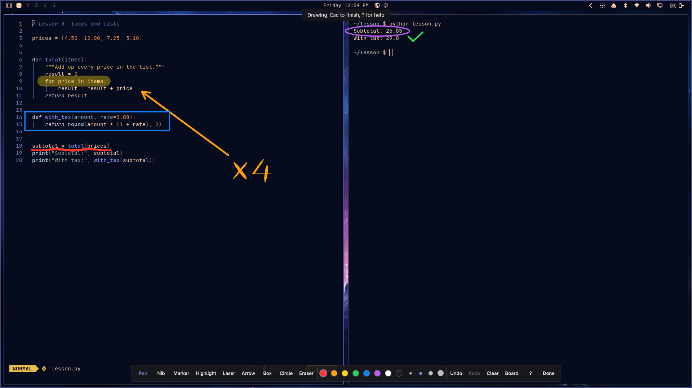

# OmaInk

Draw over your whole screen while you teach, present or record, using a mouse,
a pen tablet, or an iPad's Apple Pencil. The ink floats above every app, so any
screen recorder, OBS, Zoom or Meet picks it up. When you aren't drawing, clicks
go straight through to the apps underneath.



- **Pen** with pressure, a **calligraphy nib** whose strokes are thin along
  the nib and full width across it, a **marker**, a **highlighter**, and a
  **laser pointer** that fades away.
- **Arrows, boxes and circles**, an **eraser**, undo and redo, and a clear
  that undo brings back.
- **White or dark board**, for when you want a blank page instead of the screen.
- **iPad or any tablet as the drawing pad.** Open the address OmaInk shows (or
  scan its QR code) in Safari. Your computer's screen appears on the tablet,
  and what you draw there shows up live on the computer. You don't need to
  install anything on the tablet.

## Install

```sh
bin/install
```

This builds the package and installs it with `makepkg`. OmaInk then shows up in
the app launcher (`Super + Space`). It needs `layer-shell-qt` and `grim`, which
the package pulls in, plus `qrencode` if you want the pairing QR code.

To toggle drawing with a key, add a line to `~/.config/hypr/bindings.lua`:

```lua
o.bind("SUPER + ALT + D", "Draw on screen", "omaink toggle")
```

On an older Omarchy that still has `~/.config/hypr/bindings.conf`, add this
instead:

```ini
bindd = SUPER ALT, D, Draw on screen, exec, omaink toggle
```

## Use

Press your key (or pick OmaInk in the launcher) to start drawing on the screen
you're working on. A thin frame and the toolbar show that clicks are going to
the ink. Press `Esc` to get your desktop back. The ink stays on screen until
you clear it.

| Key | Does |
| --- | --- |
| `P` `C` `M` `H` | Pen, calligraphy nib, marker, highlighter |
| `L` | Laser pointer |
| `A` `R` `O` | Arrow, box, circle |
| `E` | Eraser (right-click also erases, with any tool) |
| `1`–`8` | Colors |
| `[` `]` | Thinner, thicker |
| `N` | Nib angle (15°, 30°, 45°, 0°) |
| `W` | White board, dark board, none |
| `Ctrl+Z` / `Ctrl+Shift+Z` | Undo / redo |
| `Delete` | Clear |
| `T` | Move the toolbar to the other edge |
| `Esc` or `Space` | Stop drawing |
| `?` | Show every shortcut and the tablet's address |
| `Q` | Quit (asks first if there's ink) |

### Drawing from an iPad

1. Put the iPad on the same Wi-Fi as the computer.
2. Run `omaink pad` in a terminal and scan the QR code it prints with the
   iPad's camera, or open the address in Safari. While drawing, `?` shows
   the same QR code on screen.
3. Tap **Share → Add to Home Screen** to give the pad its own icon.

The address includes a pairing key, so other people on the network can't see
your screen or draw on it. `omaink pad reset` makes a new key if you've shared
the old one. The key is stored in `~/.local/state/omaink/pad-key`.

On the iPad the tools are on the left. A two-finger tap undoes and a
three-finger tap redoes. After you've used the Pencil, fingers no longer draw,
so your palm can rest on the glass. The screen button turns the mirror of the
computer's screen on or off.

## Commands

Every action is also a command, so you can script OmaInk or bind it to keys.
Each command talks to the running copy, or starts one if it needs to.

```text
omaink [open]          start
omaink toggle          start or stop drawing
omaink draw | done     start or stop drawing
omaink visible         show or hide the ink
omaink undo | redo | clear
omaink board [white|dark|off]
omaink tool <pen|calligraphy|marker|highlighter|laser|arrow|rect|ellipse|eraser>
omaink color <#hex>
omaink pad [reset]     the tablet's address
omaink status          what it's doing (add --json for scripts)
omaink quit
```

Options: `--output HDMI-A-1` picks the starting screen, `--port 7777` sets the
tablet port, and `--no-pad` turns the tablet pad off.

## How it works

- The overlay is a transparent Qt Quick window on the compositor's overlay
  layer (`wlr-layer-shell`, through `layer-shell-qt`). It covers the whole
  screen, bar included. While you aren't drawing it takes no input, so clicks
  and keys go through it to your apps.
- Strokes are stored as fractions of the screen, with widths measured against
  a screen 1080 pixels high, so the same stroke lines up on the overlay and on
  a tablet of any size.
- The tablet pad is a small web page that the app serves itself over HTTP and
  a WebSocket on port 7777. The screen mirror is `grim` capturing the
  overlay's screen about five times a second.
- `src/inkrenderer.cpp` draws the ink on the computer and `src/web/pad.js`
  draws it on the tablet, using the same math. Change them together.

## Develop

```sh
bin/build    # build/omaink
bin/test     # unit tests, offscreen
bin/install  # package and install
```

## License

MIT. The theme and language support and the build scripts come from Omacut and
Monologue by David Heinemeier Hansson, also MIT.
